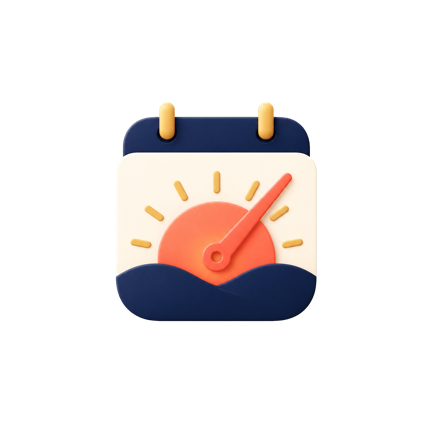
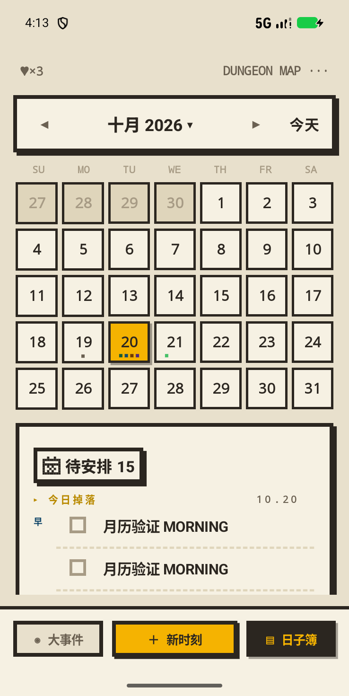
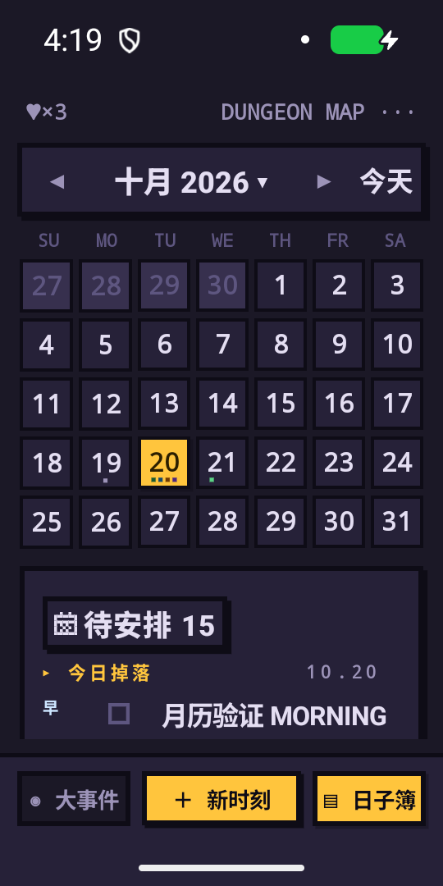
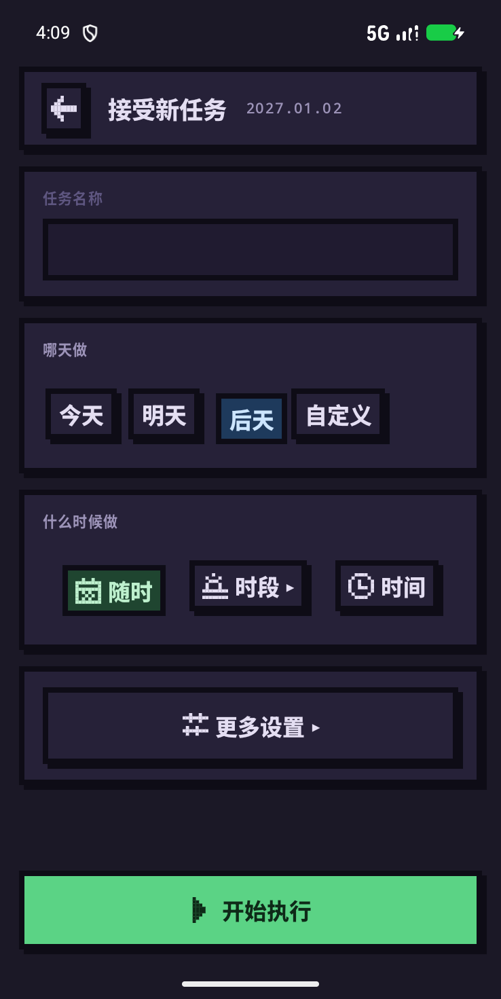

<div align="center">



# 刻间 · Moment Mark

**把重要的日子刻下来，把平凡的一天过成冒险。**

一款像素冒险风格的 Android 日期记录与每日计划 App。<br />
收藏值得铭记的时刻，也为今天的小事留一个位置。


<br />
<br />

[大事件](#moments) · [日子簿](#daybook) · [开始使用](#getting-started) · [构建运行](#build)

</div>

---

## 📱 界面预览

<div align="center">





**亮色日子簿 · 深色日子簿 · 创建任务**

<sub>真实 Android 界面，截取于 2026-10-20 的模拟器验收；内容为演示数据。深色月历使用大字号配置。</sub>

</div>

## ✨ 给时间一点仪式感

有些日子，值得期待；有些时刻，值得回望。<br />
还有一些小事，只需要今天认真完成。

刻间把它们放进两个独立的空间：**大事件**记录时间的意义，**日子簿**承接每天的行动。像素边框、立体按钮、任务卡片与昼夜配色，让记录多一点冒险感。

<a name="moments"></a>

## 🏆 大事件：把值得记住的日子留下来

为旅行、考试、纪念日或人生的新起点，留下一张专属卡片。

- **向未来倒数**：记录目标日期，查看距离那一天还有多久。
- **向过去回望**：记录已经发生的时刻，让走过的日子持续累积。
- **补上故事**：填写标题、备注与重要度，再次打开时读懂当时的心情。
- **随时整理**：支持新建、编辑、封印与恢复，让记录有来处，也有归处。

<a name="daybook"></a>

## 📖 日子簿：让今天的事情有处安放

从月历进入某一天，把待办排进自己的生活节奏。

- **按日查看**：滑动切换月份，选择日期，查看当天的任务与状态标记。
- **按节奏安排**：支持早、中、晚、随时，也可以指定精确的计划时间。
- **分清轻重**：用重要标记、精力档位和独立截止时间表达任务要求。
- **照顾日常习惯**：支持每天或按星期重复，并可管理系列、编辑规则、跳过当次、暂停或停止。
- **接住未完成**：通过待安排入口处理过去未完成的单次任务，也支持配置自动顺延。
- **看见完成**：勾选后，标题原位划线，再进入已完成列表；需要时可以取消完成。

> 任务属于哪一天，由计划日期决定；计划时间和截止时间分别设置。

## 🌗 昼夜之间，记录都在

**亮色 · 深色 · 跟随系统**<br />
显示模式可切换并保存，让白天与夜晚各有自己的配色。

**封印 · 复活 · 净化**<br />
暂时移出的记录进入「封印之地」，可以恢复；确认不再需要时，再永久删除。

**本地记录，随时打开**<br />
时刻和任务保存在本机数据库，显示偏好单独保存。当前没有账号登录和云同步功能，系统通知提醒尚未接入。

<a name="getting-started"></a>

## 🧭 开始使用

1. 进入 **大事件**，点击底部 **＋ 新时刻**，记下一个值得期待或回望的日子。
2. 切到 **日子簿**，选择日期，创建任务并安排时段。
3. 完成后勾选任务，在 **已完成** 中回看当天的进度。
4. 需要调整外观或找回记录时，进入设置，切换显示模式或打开 **封印之地**。

<a name="build"></a>

## 🛠 构建运行

需要 **JDK 17 或以上版本**、Android SDK 36，以及一台 **Android 8.0 或以上**的设备或模拟器。首次构建需要联网下载依赖。

```bash
git clone https://github.com/k2k5k8/time.git
cd time
```

使用 Android Studio 打开项目，完成 Gradle 同步后运行 `app`；也可以在项目根目录执行：

```bash
# 构建 Debug 安装包
./gradlew assembleDebug

# 安装到已连接的设备或模拟器
./gradlew installDebug
```

Debug 安装包位置：

```text
app/build/outputs/apk/debug/app-debug.apk
```

<details>
<summary><b>技术与目录</b></summary>

<br />

- **界面**：Jetpack Compose、Material 3、自定义像素风组件与主题。
- **状态与数据流**：ViewModel、Kotlin Coroutines、Flow。
- **本地存储**：Room 保存时刻和任务，Preferences DataStore 保存显示偏好。
- **应用结构**：单 Activity、单 `app` 模块；Moment 与 Task 保持独立数据模型。

```text
app/src/main/
├── java/com/cch/momentmark/
│   ├── data/          # 数据库、DAO 与 Repository
│   ├── domain/        # 领域模型与日期、任务规则
│   ├── ui/            # 页面、共享组件与主题
│   └── utils/         # 通用工具
├── res/               # 图标、字体与 Android 资源
└── AndroidManifest.xml

gradle/                # Gradle Wrapper 与依赖版本目录
```

仓库保留 App 源码、资源、必要构建配置，以及本 README 和精选界面截图。测试、设计稿、开发记录与完整验收附件在本地维护，不随仓库发布。

</details>

---

<div align="center">

**每一个被记住的日子，都在为生活增加一点重量。**

<sub>Moment Mark · 刻间</sub>

</div>
